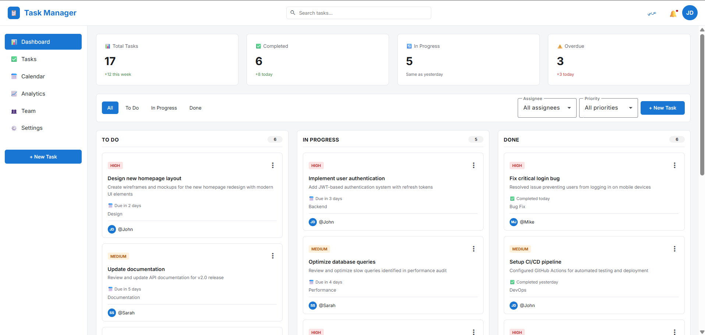

# Task Manager — Angular 21 Task Management Dashboard

A task management dashboard built with **Angular 21**, **Angular Material**, **Signals** and a mock REST API.
It follows the provided Figma design (`docs/design/`) and works on desktop, tablet and mobile, in **English and Arabic (RTL)**.



---

## Table of contents

1. [Features](#features)
2. [Getting started](#getting-started)
3. [Available scripts](#available-scripts)
4. [Environment configuration](#environment-configuration)
5. [Project structure](#project-structure)
6. [Architecture decisions](#architecture-decisions)
7. [State management](#state-management)
8. [API, caching, retry and errors](#api-caching-retry-and-errors)
9. [Forms](#forms)
10. [Internationalization (i18n)](#internationalization-i18n)
11. [Performance](#performance)
12. [Accessibility and responsive design](#accessibility-and-responsive-design)
13. [Testing strategy](#testing-strategy)
14. [Code quality and conventions](#code-quality-and-conventions)
15. [Data notes and edge cases](#data-notes-and-edge-cases)
16. [Known limitations and future improvements](#known-limitations-and-future-improvements)

---

## Features

| Area       | What you can do                                                                                                         |
| ---------- | ----------------------------------------------------------------------------------------------------------------------- |
| Tasks      | Create, edit (modal), delete (confirmation dialog), drag & drop between columns to change status (or use the card menu) |
| Filters    | Status tabs (All / To Do / In Progress / Done), priority, assignee                                                      |
| Search     | Real-time search on title and description (debounced, in the header)                                                    |
| Dashboard  | Statistics cards (total, completed, in progress, overdue) and a Kanban-style board                                      |
| Tasks page | The same tasks and filters in a table                                                                                   |
| Analytics  | Doughnut chart by priority, bar chart by status (Chart.js), recent activity feed                                        |
| Team       | Mocked user list with open / done / overdue counts and a shortcut to their tasks                                        |
| UX         | Skeleton loading, error state with retry, snackbars, card animations, hover states from the design                      |
| i18n       | English and Arabic with a language switch, right-to-left layout for Arabic                                              |

---

## Getting started

**Requirements:** Node.js 22 (24 LTS recommended) and npm 10+.

Tested on Node 22 and Node 26.

```bash
npm install
npm start
```

Open http://localhost:4200.

To refresh the mock data so the dates are relative to today:

```bash
npm run generate-data
```

> `.npmrc` sets `legacy-peer-deps=true` because one npm 10 version crashes while resolving the peer dependencies of the test tools. It does not change the installed versions.

---

## Available scripts

| Command                           | Description                                                  |
| --------------------------------- | ------------------------------------------------------------ |
| `npm start`                       | Dev server on port 4200                                      |
| `npm run build`                   | Production build in `dist/`                                  |
| `npm test`                        | Unit tests (Vitest) in watch mode, with coverage             |
| `npm run test:ci`                 | Unit tests once, with the coverage report and 80% thresholds |
| `npm run lint`                    | ESLint (TypeScript + templates + accessibility rules)        |
| `npm run format` / `format:check` | Prettier                                                     |
| `npm run generate-data`           | Regenerates `data-fetching/tasks.json` and `statistics.json` |

Coverage HTML report: `coverage/task-dashboard/index.html`.

---

## Environment configuration

There is no real backend, so no environment variables are needed.
The mock API is configured in `src/app/app.config.ts`:

```ts
HttpClientInMemoryWebApiModule.forRoot(InMemoryDataService, { delay: 600 });
```

- `delay` simulates network time so loading skeletons are visible.
- To use a real API later, remove this provider and change `API_URLS` in `core/api/task-api.service.ts`.
  Nothing else changes, because components only talk to `TaskStore`.

---

## Project structure

```
data-fetching/            generate-data.js + generated JSON (the mock database)
docs/design/              design screenshots
src/app/
  core/                   app-wide code, no UI
    api/                  in-memory backend + TaskApiService (POST / PUT / DELETE)
    interceptors/         cache, retry, error
    i18n/                 en.json, ar.json, translation loader
    models/               TypeScript types
    services/             TaskStore (state), LanguageService, NotificationService
    utils/                date helpers, due-date label
  layout/                 shell, header, sidebar
  shared/                 reusable presentational components, dialogs, validators, pipes
  features/               one folder per lazy-loaded page
    dashboard/            stats + filter bar + board
    tasks/                table view
    analytics/            charts + activity feed
    team/                 user list
    coming-soon/          placeholder for Calendar and Settings
src/testing/              test helpers and sample data
```

---

## Architecture decisions

### Standalone components, no NgModules

Every component is standalone and imports only what it uses. This is the default in Angular 21 and makes dependencies easy to see.

### Smart vs presentational components

- **Smart (pages):** `DashboardPage`, `TasksPage`, `AnalyticsPage`, `TeamPage`. They inject `TaskStore` and pass data down.
- **Presentational:** `TaskCard`, `StatCard`, `FilterBar`, `TaskBoard`, `TaskTable`, `TaskChart`, `ActivityFeed`, `Sidebar`.
  They only use `input()` / `output()` / `model()`, never inject the store, and are easy to test.

Example from the dashboard:

```html
<app-filter-bar
  [(status)]="store.statusFilter"
  [users]="store.users()"
  (newTask)="taskDialog.openCreate()"
/>
```

### Drag & drop

`TaskBoard` uses Angular CDK (`cdkDropListGroup`, `cdkDropList`, `cdkDrag`). Each column's drop list carries its status, so a drop into another column emits the same `statusChange` event the card menu uses, and the store saves it. The board stays presentational. On touch screens a short long-press starts the drag, so the page can still scroll.

### Dependency injection

- `inject()` instead of constructor parameters.
- Services are `providedIn: 'root'` (tree-shakable singletons).
- `TaskDialogService` hides `MatDialog` details, so pages just call `openCreate()`, `openEdit(task)` or `confirmDelete(task)`.
- Chart.js is provided at the chart component level, so it is only loaded with the analytics page.

### SOLID in practice

- **Single responsibility:** reading/state (`TaskStore`), writing (`TaskApiService`), dialogs (`TaskDialogService`), messages (`NotificationService`), and each interceptor does one job.
- **Open/closed:** new filters or stats are added as new `computed()` signals without changing components.
- **Dependency inversion:** components depend on the store API, not on HTTP. Swapping the mock API for a real one does not touch UI code.

---

## State management

I used a **signal-based store service** (`core/services/task-store.ts`) instead of NgRx. For an app of this size it gives the same benefits (one source of truth, derived state, predictable updates) with much less code, and signals are what the assignment asks for.

```
httpResource (server data) ──► linkedSignal tasks (local copy) ──► computed: filteredTasks, columns, stats, activities
                                        ▲
             create / update / delete ──┘ (updated after the server confirms)
```

- **`httpResource`** loads tasks, users and statistics. It gives `isLoading()`, `error()`, `value()` and `reload()` for free.
- **`linkedSignal`** keeps a local, editable copy of the tasks. It resets automatically when the resource reloads.
- **`computed`** derives everything else, so the stats, board, charts and team counts always match after any change.
- **Filters** are plain `signal`s. Components bind to them with two-way `model()` binding.
- **Writes** use `HttpClient` (POST / PUT / DELETE). On success the local list is updated, so the UI does not reload or flicker.

---

## API, caching, retry and errors

Mock backend: `angular-in-memory-web-api` serves the generated JSON at `api/tasks`, `api/users` and `api/statistics`. It runs inside the app, so it also works on static hosting.

Interceptors (in `core/interceptors/`), registered in this order:

| Interceptor        | What it does                                                                                                                     |
| ------------------ | -------------------------------------------------------------------------------------------------------------------------------- |
| `errorInterceptor` | Shows a translated snackbar for any failed request, then rethrows                                                                |
| `cacheInterceptor` | Caches GET responses for 60 seconds; any POST/PUT/DELETE clears the cache                                                        |
| `retryInterceptor` | Retries GET requests on network or 5xx errors, 2 times, waiting 500ms then 1000ms. Writes are never retried, to avoid duplicates |

Because the error interceptor is first, the user sees **one** message after all retries fail, not one per attempt.
If loading still fails, pages show an error state with a **Try again** button that calls `store.reload()`.

RxJS and memory leaks: HTTP observables complete on their own; the only long-lived subscription (header search) uses `takeUntilDestroyed()`; everything else uses signals or `toSignal()`.

---

## Forms

`shared/components/task-form-dialog` uses **typed Reactive Forms** (`NonNullableFormBuilder`).

- **Custom validators** (`shared/validators/task.validators.ts`):
  - `notBlankValidator`: rejects titles that are only spaces
  - `notInPastValidator`: due date cannot be in the past (new tasks only, so old overdue tasks can still be edited)
  - `uniqueTagsValidator`: no duplicate tags (case-insensitive)
- **Dynamic form controls:** tags are a `FormArray`; controls are added and removed at runtime (max 5).
- **Form state:** submit is blocked when invalid and all fields are marked as touched to show errors.
- **Error display:** `getErrorMessage()` turns the first validation error into a translation key, shown with `<mat-error>`.

---

## Internationalization (i18n)

- Library: **ngx-translate**, because it switches language at runtime without rebuilding (Angular's built-in i18n creates one build per language).
- Files: `src/app/core/i18n/en.json` and `ar.json`. They are loaded with dynamic `import()`, so each language is its own small lazy chunk.
- `LanguageService` switches the language, sets `<html lang dir>`, passes the direction to Material (sidenav, dialogs) and saves the choice in `localStorage`.
- All styles use logical CSS properties (`margin-inline-start`, `border-inline-start`...), so the layout mirrors correctly in Arabic.
- Relative times use the browser's `Intl.RelativeTimeFormat` in the current language.
- Text that comes from the API (task titles, tags, names) is data and is not translated.

---

## Performance

- **OnPush everywhere**, enforced by an ESLint rule; the app is **zoneless**.
- **Lazy loading:** every route uses `loadComponent`. The task form and confirm dialogs are also loaded on first use, and Chart.js loads only with the analytics page.
- **`track`** in every `@for`, and `trackBy` on the Material table.
- **Signals + `computed`** recalculate only when their inputs change.
- **Debounced search** (250ms) to avoid filtering on every key press.
- **HTTP caching** to avoid repeated GET requests.

Production build: about 176 kB transferred for the initial load; each page is a separate chunk.

---

## Accessibility and responsive design

- Semantic HTML (`header`, `nav`, `main`, `article`, lists, headings), a skip-to-content link, `aria-current` on the active link, `aria-pressed` on filter tabs, labels on all icon buttons.
- Keyboard: everything is reachable with Tab; dialogs trap focus (Material); visible focus outlines.
- Drag & drop needs a mouse or touch, so every card also has a **Move to …** menu that works with the keyboard and screen readers.
- Charts have a visually hidden text list with the same numbers for screen readers.
- `prefers-reduced-motion` turns animations off.
- ESLint template accessibility rules are on.
- Responsive: the desktop design is the base. Stats go 4 → 2 columns, the board goes from 3 columns to 1, filters stack, and the sidebar becomes a slide-in menu below 960px.

---

## Testing strategy

- **Runner:** Vitest through Angular's `@angular/build:unit-test` builder. It is the default for new Angular 21 projects and much faster than Karma.
- **Coverage:** ~95% statements, ~94% branches, ~90% functions, ~97% lines (threshold set to 80% in `angular.json`).
- **What is tested:**
  - Pure logic: date helpers, due-date labels, validators, time-ago pipe
  - Interceptors with `HttpTestingController` (cache hit/expiry/clear, retry timing with fake timers, error messages)
  - `TaskStore` with mocked HTTP: loading, errors, filters, search, stats, create/update/delete, activity feed
  - Presentational components: inputs render correctly, outputs emit
  - **Integration tests:** pages rendered with the real `TaskStore` and mocked HTTP (`DashboardPage`, `TasksPage`, `TeamPage`, `AnalyticsPage`)
  - Services with mocks: `TaskDialogService` (mocked `MatDialog`), `NotificationService`, `LanguageService`
- Shared test data and providers are in `src/testing/test-helpers.ts`.

---

## Code quality and conventions

- **ESLint** (`eslint.config.js`): Angular recommended + template accessibility, plus project rules:
  - Inline `template` or `styles` longer than **10 lines must move to their own `.html` / `.scss` file**
    (`@angular-eslint/component-max-inline-declarations`)
  - OnPush required, signals preferred, no `any`, new control flow (`@if`, `@for`) required
- **Prettier** for formatting.
- **Husky**: `pre-commit` runs ESLint + Prettier on staged files (lint-staged); `commit-msg` checks **conventional commits** (commitlint).
- **Comments:** short and only where the reason is not obvious from the code. JSDoc is used on the more complex logic (store, interceptors, date helpers, validators).
- **Naming:** Angular 21 style guide (`task-card.ts` with class `TaskCard`, no `.component` suffix).

---

## Data notes and edge cases

Things found in the provided data and how they are handled:

| Issue                                                         | Handling                                                                                                             |
| ------------------------------------------------------------- | -------------------------------------------------------------------------------------------------------------------- |
| `isOverdue` is only on 3 tasks and never updates              | Always calculated: not done **and** due date before today                                                            |
| A done task with a past due date                              | Never counted as overdue                                                                                             |
| `completedAt` only exists on done tasks                       | Optional in the model; set when moving to Done, removed when moving back                                             |
| Statistics API numbers (156, 89...) do not match the 17 tasks | Card values are calculated from the live tasks; only the change line (`+12 this week`) comes from the statistics API |
| No users endpoint                                             | The mock API builds `api/users` from task assignees                                                                  |
| No activity endpoint                                          | The feed starts from `createdAt` / `completedAt` and adds live events after each change                              |
| Timezone risk with date-only strings                          | Dates are compared as local calendar days, never with `new Date('YYYY-MM-DD')` (which is UTC)                        |
| Emoji icons in the statistics data                            | Kept, because the design uses the same emojis                                                                        |

Other edge cases: empty columns and empty table messages, search with no results, title with only spaces, duplicate tags, past due dates, failed saves (the list is left unchanged and an error is shown).

---

## Known limitations and future improvements

- Data lives in memory: changes are lost on page reload (could persist with `localStorage` or a real API).
- Calendar and Settings are placeholders; they are in the design but not in the requirements.
- Drag & drop changes the status only. Reordering inside a column is turned off because the data has no position field, so a custom order could not be saved (and is unclear while filters hide some cards).
- Filters are not saved in the URL yet (query params would make filtered views shareable).
- The change labels on the stat cards (`+12 this week`) come from a static API and are not calculated.
- Next steps: e2e tests (Playwright), dark mode, CI pipeline, Docker.
